<!-- ===================== HEADER ===================== -->
<p align="center">
  
</p>

<p align="center">
  <a href="https://isslemjomaa.github.io">
    
  </a>
</p>

<p align="center">
  <a href="https://isslemjomaa.github.io"></a>
  <a href="https://www.linkedin.com/in/islem-jomaa-97278a1a9/"></a>
  <a href="mailto:ijomaa@lakeheadu.ca"></a>
</p>

<!-- ===================== PORTFOLIO CARD ===================== -->
<p align="center">
  <a href="https://isslemjomaa.github.io">
    
  </a>
</p>

## 👩‍💻 About me

```python
class Islem:
    def __init__(self):
        self.role       = "Industrial Computer Engineer — Intelligent & Interconnected Systems"
        self.education  = "ENET'COM, Tunisia (Engineering Diploma, 2026)"
        self.now        = "Research Collaborator @ VIDLab, Canada — Multi-Drone Detection & Tracking"
        self.previously = "AI Engineer Intern @ Lakehead University (Mitacs Globalink) — LiDAR Segmentation"
        self.focus      = ["Computer Vision", "3D Perception", "LiDAR Point Clouds", "Multimodal AI", "Robotics"]
        self.languages  = {"Arabic": "Native", "French": "C1", "English": "B2", "German": "A1"}
        self.portfolio  = "https://isslemjomaa.github.io"

    def motto(self):
        return "Turning sensor data into machines that understand the world 🌍"
```

- 🔭 Currently exploring **multimodal learning for multi-drone object detection and tracking** at VIDLab
- 🚗 Built a **3D perception pipeline for autonomous driving**: voxel-based LiDAR semantic segmentation trained on **HPC clusters**
- 🤖 I enjoy bridging **deep learning and robotics** with ROS2 & Gazebo
- 🌐 See everything in one place on my **[portfolio](https://isslemjomaa.github.io)**
- 🌱 Open to **research and engineering opportunities** in computer vision, 3D perception and autonomous systems

---

## 🛠️ Tech stack

<p align="center">
  
  <br/>
  
</p>

<p align="center">
  
  
  
  
  
  
  
  
  
</p>

---

## 🚀 Featured projects

<table>
  <tr>
    <td width="50%" valign="top">
      <h3><a href="https://github.com/isslemjomaa/pfe-lidar-segmentation">🛰️ LiDAR Semantic Segmentation</h3>
      <p><i>Final-year project · Lakehead University · Apr–Aug 2026</i></p>
      <p>Deep learning 3D perception pipeline for autonomous driving: voxel-based segmentation architectures trained and evaluated on HPC across multiple benchmark datasets, plus an exploration of LiDAR–camera feature fusion.</p>
      <p><code>PyTorch</code> <code>CUDA</code> <code>HPC</code> <code>Point Clouds</code></p>
    </td>
    <td width="50%" valign="top">
      <h3><a href="https://github.com/isslemjomaa/LiDAR-Camera-Fusion-for-3D-Object-Detection">🚗 LiDAR–Camera Fusion for 3D Detection</a></h3>
      <p><i>IMSR Engineering · Jun–Aug 2025</i></p>
      <p>Dual-stream architecture with intermediate feature fusion and a 3D detection head on KITTI, integrated in ROS2 Humble and validated in Gazebo.</p>
      <p><code>PyTorch</code> <code>ROS2</code> <code>Gazebo</code> <code>KITTI</code></p>
    </td>
  </tr>
  <tr>
    <td width="50%" valign="top">
      <h3>🗣️ Human–Robot Interaction (LLM + ROS2)</h3>
      <p><i>Academic project · Nov 2025</i></p>
      <p>Speech recognition plus a LLaMA-based NLP module that interprets natural-language commands, bridging language understanding and robotic perception.</p>
      <p><code>LLaMA</code> <code>ROS2</code> <code>Gazebo</code> <code>NLP</code></p>
    </td>
    <td width="50%" valign="top">
      <h3><a href="https://github.com/isslemjomaa/-Solar-Panel-Dust-Detection">☀️ Solar Panel Dust Detection</a></h3>
      <p><i>PFA · Nov 2024–Apr 2025</i></p>
      <p>CNN/VGG16 models for classifying dust accumulation on solar panels, with web interfaces for automated monitoring and notifications.</p>
      <p><code>TensorFlow</code> <code>VGG16</code> <code>Web</code></p>
    </td>
  </tr>
  <tr>
    <td width="50%" valign="top">
      <h3>🏭 Industrial Defect Detection</h3>
      <p><i>Academic project · Oct 2025</i></p>
      <p>PyTorch computer vision system for real-time deformation detection on industrial production lines.</p>
      <p><code>PyTorch</code> <code>Computer Vision</code></p>
    </td>
    <td width="50%" valign="top">
      <h3>🦷 Dental Hygiene Virtual Assistant</h3>
      <p><i>Digilog · DAAD & Leipzig University · Nov 2024</i></p>
      <p>Real-time facial recognition and deep learning models to monitor children's brushing habits within a multimodal AI system.</p>
      <p><code>Deep Learning</code> <code>Face Recognition</code></p>
    </td>
  </tr>
</table>

<p align="center">
  <a href="https://isslemjomaa.github.io/#projects"></a>
</p>

---

## 💼 Experience

<table>
  <tr>
    <td width="24%" align="center" valign="top">
      <br/>
      <sub>🇨🇦 Canada · Remote</sub>
    </td>
    <td valign="top">
      <b>🔬 Research Collaborator</b><br/>
      <i>VIDLab · Vision Intelligence and Data Laboratory</i><br/>
      <sub>Multimodal learning for <b>multi-drone object detection &amp; tracking</b> from aerial data.</sub><br/>
      <code>Multimodal AI</code> <code>Detection</code> <code>Tracking</code> <code>Drones</code>
    </td>
  </tr>
  <tr>
    <td width="24%" align="center" valign="top">
      <br/>
      <sub>🇨🇦 Thunder Bay, Canada</sub>
    </td>
    <td valign="top">
      <b>🛰️ AI Engineer Intern (PFE) · Mitacs Globalink</b><br/>
      <i>Lakehead University</i><br/>
      <sub>LiDAR point cloud analysis, <b>from classification to semantic segmentation</b>: voxel-based architectures, LiDAR–camera feature fusion exploration, and end-to-end training on HPC.</sub><br/>
      <code>PyTorch</code> <code>CUDA</code> <code>HPC</code> <code>Point Clouds</code>
    </td>
  </tr>
  <tr>
    <td width="24%" align="center" valign="top">
      <br/>
      <sub>🇹🇳 Tunisia</sub>
    </td>
    <td valign="top">
      <b>🤖 AI &amp; Robotics Intern</b><br/>
      <i>IMSR Engineering</i><br/>
      <sub>Dual-stream <b>LiDAR–camera fusion</b> network with a 3D detection head on KITTI, deployed in ROS2 Humble and validated in Gazebo.</sub><br/>
      <code>PyTorch</code> <code>ROS2</code> <code>Gazebo</code> <code>KITTI</code>
    </td>
  </tr>
  <tr>
    <td width="24%" align="center" valign="top">
      <br/>
      <sub>🇹🇳 Tunisia</sub>
    </td>
    <td valign="top">
      <b>💻 IT Intern</b><br/>
      <i>Draexlmaier Group</i><br/>
      <sub><b>PowerApps helpdesk</b> with Power Automate for ticket automation, alerting and real-time dashboards.</sub><br/>
      <code>PowerApps</code> <code>Power Automate</code> <code>Dashboards</code>
    </td>
  </tr>
</table>

---

## 🏆 Awards & achievements

<table>
  <tr>
    <td width="33%" align="center" valign="top">
      <h1>🥇</h1>
      <b>1st Prize</b><br/>
      <sub>JET'Impact</sub><br/><br/>
      <sub><i>VitaPaw</i>: AI-based animal health monitoring</sub>
    </td>
    <td width="33%" align="center" valign="top">
      <h1>🥈</h1>
      <b>2nd Prize</b><br/>
      <sub>International Process Optimization Challenge</sub><br/><br/>
      <sub>DAAD · Leipzig University</sub>
    </td>
    <td width="33%" align="center" valign="top">
      <h1>🎓</h1>
      <b>Engineering Diploma</b><br/>
      <sub>Mention <i>Très Bien</i></sub><br/><br/>
      <sub>ENET'COM · 2026</sub>
    </td>
  </tr>
  <tr>
    <td width="33%" align="center" valign="top">
      <h1>💡</h1>
      <b>Student Entrepreneur (SNEE)</b><br/>
      <sub>Level 2</sub><br/><br/>
      <sub><i>Étudiant Entrepreneur Innovateur</i></sub>
    </td>
    <td width="33%" align="center" valign="top">
      <h1>🤖</h1>
      <b>Media Manager &amp; Event Organizer</b><br/>
      <sub>EnetRobot 4.0 &amp; 5.0</sub><br/><br/>
      <sub>ENET'COM Robotics Club</sub>
    </td>
    <td width="33%" align="center" valign="top">
      <h1>📜</h1>
      <b>Certification</b><br/>
      <sub>LLM Engineering in Practice</sub><br/><br/>
      <sub>Streamlit &amp; OpenAI · 365 Data Science</sub>
    </td>
  </tr>
</table>

---

## 📊 GitHub stats

<p align="center">
  
  
</p>
<p align="center">
  
</p>

<!-- Snake animation: needs the workflow in .github/workflows/snake.yml -->
<p align="center">
  <picture>
    <source media="(prefers-color-scheme: dark)" srcset="https://raw.githubusercontent.com/isslemjomaa/isslemjomaa/output/github-snake-dark.svg" />
    <source media="(prefers-color-scheme: light)" srcset="https://raw.githubusercontent.com/isslemjomaa/isslemjomaa/output/github-snake.svg" />
    
  </picture>
</p>

---

## 🤝 Let's connect

I'm always happy to talk with engineers, researchers and teams working on AI, computer vision, robotics, autonomous systems and industrial innovation.

<p align="center">
  <a href="https://isslemjomaa.github.io"><b>🌐 Portfolio</b></a> ·
  <a href="https://www.linkedin.com/in/islem-jomaa-97278a1a9/"><b>💼 LinkedIn</b></a> ·
  <a href="mailto:ijomaa@lakeheadu.ca"><b>✉️ Email</b></a>
</p>

<p align="center">
  <i>Thanks for visiting my profile! ✨</i>
</p>

<!-- ===================== FOOTER ===================== -->
<p align="center">
  
</p>
